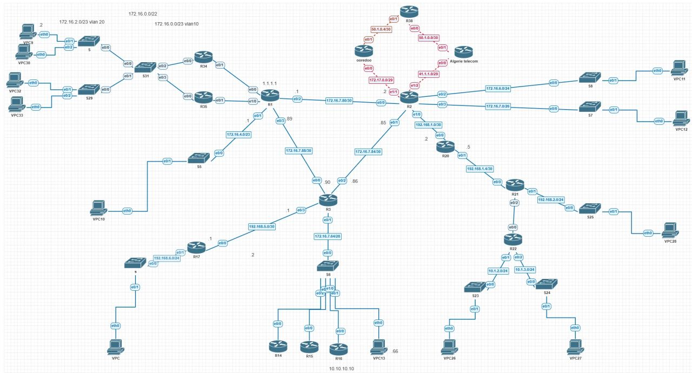

# Enterprise Multi-Site Network – PNETLab

A hands-on enterprise networking lab designed, configured, and tested in **PNETLab**. The project brings together routing, switching, gateway redundancy, WAN connectivity, and troubleshooting in a multi-site topology.

> **Scope:** This repository documents the PNETLab project only. It does not include Packet Tracer material.

## Network Topology



The topology connects multiple router and switch segments, user VLANs, remote network segments, and simulated ISP links.

## Technologies Implemented

- Multi-Area OSPF
- RIP and route redistribution into OSPF
- Static routing
- Inter-VLAN routing and VLAN segmentation
- HSRP gateway redundancy
- IP SLA tracking and failover logic
- Dual-ISP connectivity and WAN redundancy
- NAT/PAT
- VLSM addressing
- EtherChannel using LACP and PAgP

## Verification Evidence

The following screenshots were captured from the lab:

| Evidence | What it shows |
|---|---|
| [HSRP verification](screenshots/hsrp-verification.png) | `show standby brief` output showing Active/Standby roles for VLAN subinterfaces |
| [IP SLA tracking](screenshots/ip-sla-tracking.png) | `show track` output showing the tracked IP SLA operations in an Up state |
| [Internet connectivity](screenshots/internet-connectivity.png) | Successful ping replies from a VPCS host to `8.8.8.8` |
| [OSPF database](screenshots/ospf-database.png) | OSPF Link-State Database information for Area 0 |

## Repository Structure

```text
enterprise-multi-site-network-pnetlab/
├── README.md
├── topology/
│   └── network-topology.png
├── screenshots/
│   ├── hsrp-verification.png
│   ├── ip-sla-tracking.png
│   ├── internet-connectivity.png
│   └── ospf-database.png
└── documentation/
    └── network-design.md
```

## Project Notes

- The lab was built and tested in PNETLab.
- The screenshots in this repository are the verification evidence currently available.
- Device configuration exports and additional test evidence (for example, EtherChannel status, OSPF neighbor state, and ISP failover tests) can be added later.
- No device configuration files are included yet because the lab has not been exported from PNETLab.

## Author

**Ibrahim Larabi**
